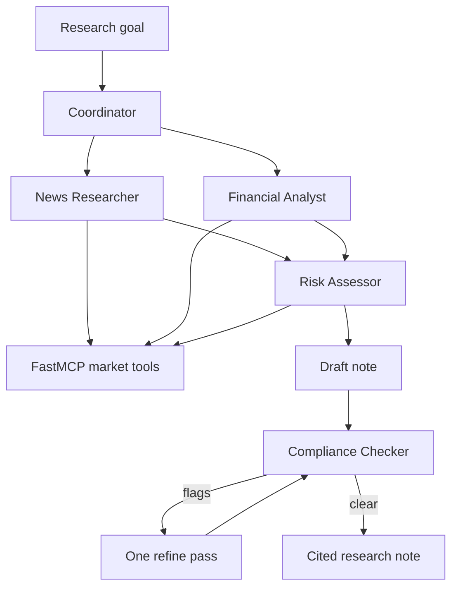

# Capstone 5 — Financial News Research Coordinator

A coordinator takes a research question and hands it to four specialists: a news researcher, a financial analyst, a risk assessor, and a compliance checker. News and the analyst run at the same time. Risk reads both of those reports. The coordinator writes a draft, the compliance checker screens it, and one refine pass follows when the screen raises a flag.

This is capstone 5 of 5 in the course brief (the Module 4 multi-agent build). The same five tools are exposed by a FastMCP server, which is what the Docker image runs. The demo question is `Brief me on NVDA earnings risk`.

The note is research context. It is not a recommendation to buy, sell, or hold.

## Setup

```powershell
python -m venv .venv
.\.venv\Scripts\Activate.ps1
pip install -r requirements.txt
```

## Run

```powershell
.\.venv\Scripts\python.exe test_coordinator.py
.\.venv\Scripts\python.exe run_demo.py --offline
.\.venv\Scripts\python.exe run_demo.py
.\.venv\Scripts\python.exe coordinator.py "Brief me on NVDA earnings risk"
.\.venv\Scripts\python.exe coordinator.py "Latest headlines on AAPL"
.\.venv\Scripts\python.exe mcp_server.py
```

`run_demo.py` writes `demo_run.md`. With a chat key it calls Yahoo Finance through `yfinance` and the model. `--offline` uses a fixed NVDA fixture and skips the model. `--mcp http://localhost:8000/mcp` sends tool calls to the server instead of calling them in-process.

The MCP server listens on `http://localhost:8000/mcp`. MCP Inspector can attach to that URL:

```powershell
npx -y @modelcontextprotocol/inspector
```

Docker runs the same server:

```powershell
docker compose up --build
```

## How a question is routed

| Question | Specialists |
| --- | --- |
| Brief me on NVDA earnings risk | news, analyst, risk, compliance |
| Latest headlines on AAPL | news, compliance |
| What are MSFT margins | analyst, compliance |
| Check this copy: you should buy NVDA | compliance |

## Tools

| Tool | What it returns |
| --- | --- |
| `company_snapshot` | Last price, market cap, 52-week range |
| `recent_news` | Up to 8 headlines with publisher and URL |
| `fundamentals` | Trailing and forward P/E, margin, revenue, earnings date |
| `price_history` | Window return, high, low, annualized volatility. `days` is 5 to 90 |
| `compliance_screen` | Flags for a trade instruction, a guarantee, a risk-free claim, a certainty, a price target, or a missing disclaimer |

Tickers are 1 to 5 letters. `NVDA` and `Nvidia` both resolve. Words such as `RISK` and `IPO` are not tickers.

## Desk flow



The same desk is the Flowise agentflow in `flowise/financial_research_coordinator.json`. In Flowise, open Agentflows and import that file. Attach a ChatOpenAI credential on each agent node (`gpt-4o-mini` is already selected). The saved base path is `https://openrouter.ai/api/v1`, so the OpenRouter key from `.env` works. A key from platform.openai.com needs that base path cleared. The question `Brief me on NVDA earnings risk` starts the news researcher and the financial analyst together. Risk waits for both. The coordinator writes the draft without a disclaimer, so the compliance gate takes the revise branch and the refine node adds it.


## What each file does

- `mcp_server.py` — FastMCP server. Streamable HTTP on port 8000.
- `market.py` — ticker checks, Yahoo Finance reads, the fixture, and the compliance screen.
- `tools.py` — the five tool names and argument checks.
- `mcp_client.py` — in-process calls, or HTTP calls to a running server.
- `specialists.py` — News Researcher, Financial Analyst, Risk Assessor, Compliance Checker, and the refine rewrite.
- `coordinator.py` — routing, parallel dispatch, the draft, critique, and one refine.
- `messages.py` — the structured handoff between agents.
- `run_demo.py` — the NVDA earnings-risk brief, written to `demo_run.md`.
- `flowise/financial_research_coordinator.json` — the same coordinator, specialists, gate, and refine step as a Flowise agentflow.
